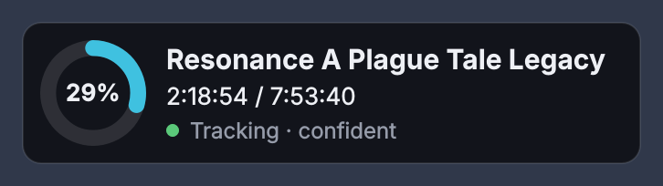
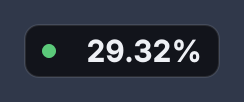

# Walkthrough Sync

    

How far into a game are you? Give it a full YouTube walkthrough and roughly
where you are in it. While you play, it watches the game window, recognises
the scenes, and keeps a small widget updated: *2:15:34 / 7:53:40 — 29%*, with
the matching walkthrough frame underneath.

Your playthrough won't look exactly like the video, but cutscenes, set pieces
and locations do, and those keep it in sync. In between, it moves forward at a
believable pace and waits for the next landmark.

<p align="center">
  
  &nbsp;&nbsp;
  
  <br><sub>The card, and <i>Minimal (percentage only)</i> from the right-click menu</sub>
</p>

## Requirements

* Windows 10 or 11
* Python 3.10–3.14 (`run.bat` finds one; PyTorch doesn't support newer versions yet)
* An NVIDIA GPU is strongly recommended (it falls back to the CPU, but analysing a long walkthrough then takes much longer)
* [Deno](https://deno.com/) or Node.js — `yt-dlp` uses it to read YouTube

## Running it

```
git clone https://github.com/viruztt/WalkthroughSync.git
cd WalkthroughSync
run.bat
```

Or download the ZIP from GitHub, extract it, and double-click **`run.bat`**. The first run creates a `.venv`, installs PyTorch
with CUDA and the other dependencies (a few GB, once), then starts the widget.
Run **`install_startup.bat`** if you want it to start with Windows.

1. **New game…** (opens on its own the first time): paste the walkthrough URL
   and roughly where you are — `1:30:00`, `1h30m`, `90m`, or a YouTube link
   with `&t=` all work.
2. It downloads a 360p copy, analyses one frame per second on the GPU, runs a
   short self-check and deletes the video again (a few minutes for an 8-hour
   walkthrough). Only the analysis (~30 MB) and small thumbnails are kept.
3. Play. Tracking starts when a fullscreen or borderless game is in the
   foreground; that program gets linked to the game, so alt-tabbing to a
   browser never counts.

## The widget

* **Donut** — percentage through the walkthrough. Then your position, and a status dot:
  green *confident*, amber *fairly sure / searching*, grey *waiting / paused*.
* **Minimal (percentage only)** (right-click): shrinks the widget to a small
  pill showing just *12.34%* and the status dot (green confident, amber unsure
  or analysing, grey waiting for the game or paused, red on errors). Hover for
  details.
* **Progress text** (right-click): the line under the name shows your position
  (*2:15:34 / 7:53:40*), the walkthrough time remaining (*5:38:06 left*), or no
  time; tick *Percentage* to add *29.3%*. With both off the line disappears.
* **Matched frame** — the walkthrough at your current spot. Click it to open the video there.
* **Double-click** to set your position by hand. **Right-click** for *Nudge*
  (±1 / ±5 min), *Pause tracking*, *Game window* (link a windowed game or a
  different program), *Games* (switch, add, rename, remove), and the usual dock,
  layer, opacity and text-size settings.
* Hover for details: best guess ± spread, confidence, what the last screenshot
  looked most like.

## How it works

1. **Index** — `yt-dlp` fetches a video-only 360p copy; `ffmpeg` decodes it in
   parallel chunks at 1 fps, 320×180. Every frame is embedded with OpenCLIP
   ViT-B/16 (the image half of CLIP) on the GPU.
2. **Capture** — every 2 seconds the game window is grabbed, cropped to 16:9
   (so ultrawide works), scaled to 320×180 and embedded the same way.
3. **Track** — a histogram filter over every second of the video:
   * *predict*: time passed, so you moved forward by 0–1.3× that much
     (players are usually slower than walkthroughs), plus a tiny chance you're
     somewhere else entirely so a wrong lock can recover;
   * *observe*: the screenshot is compared with all frames. Scores are judged
     by how much the best match stands out, so a dark corridor or a menu that
     looks like half the game barely moves anything, while a distinctive
     cutscene shot pulls hard.
   * Black screens, a frozen picture (pause menu) and time with the game in
     the background don't count.
4. **Self-check** — after indexing, it simulates slow, noisy playthroughs
   from the walkthrough's own frames and records how close it stayed (`replay.txt`).

## From the command line

```
python main.py --list                 every game and how far you are
python main.py --index URL 1h30m      analyse a walkthrough in the console
python main.py --replay [name]        re-run the self-check
python main.py --replay-session [f]   re-run the tracker over a recorded session
python main.py --selftest             tracker maths and helpers, no GPU needed
```

## Where the data lives

```
config.json                      widget settings
data/games/<game>/meta.json      name, URL, duration, your position, linked exe
data/games/<game>/emb.npy        one embedding per second of video
data/games/<game>/thumbs.*       160×90 frames every 2 s for the preview
data/games/<game>/replay.txt     self-check result
data/games/<game>/sessions/      what the tracker saw while you played: one
                                 embedding per screenshot plus a small JPEG
                                 every 30 s (~3 MB/hour; `"record_sessions":
                                 false` turns it off). `--replay-session`
                                 re-runs the tracker over one.
data/log.txt                     tracking log (useful for tuning)
models/                          the downloaded image model
```

Set `"keep_video": true` in `config.json` to keep the downloaded walkthrough.
The widget hides itself from screen captures so it never ends up in the
screenshots it matches (this also keeps it out of your own recordings and
screenshots); set `"hide_from_capture": false` to change that.
`data/`, `models/` and `config.json` are git-ignored.

## Limits

* Open-world and non-linear games, where you do things in a different order
  than the video, confuse the timeline. Linear and cutscene-heavy games work best.
* Exclusive fullscreen sometimes captures as black, and nothing can stay on top
  of it — use borderless.
* HDR can wash out captures; if tracking stays unsure, try with HDR off.

## Layout

```
main.py              entry point and CLI
run.bat              first-run installer + launcher
wsync/
  tracker.py         the histogram filter (numpy only)
  indexer.py         download, decode, embed, self-check
  embedder.py        OpenCLIP on the GPU
  capture.py         foreground game window + screen grab
  workers.py         live tracking thread, indexing thread
  sessions.py        records play sessions and replays them for tuning
  widget.py          the card, menus, tray
  dialogs.py         New game / set position
  games.py           per-game folders
  config.py          settings and helpers
```

## License

[MIT](LICENSE)
